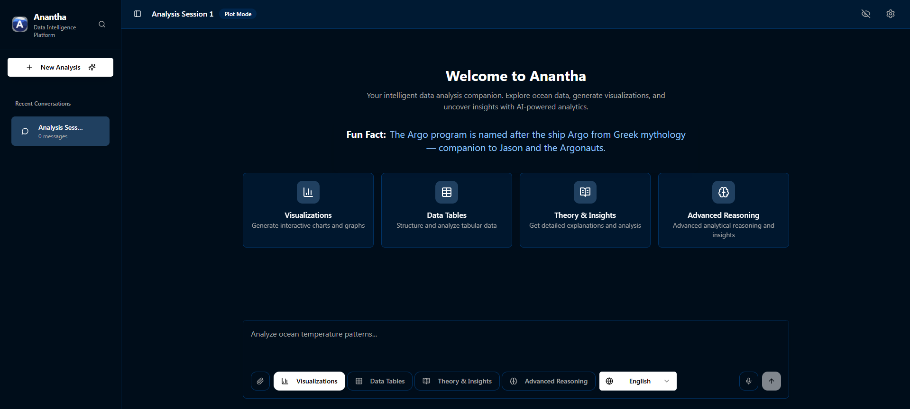
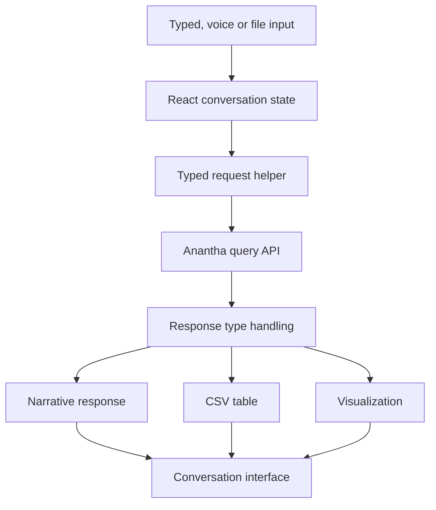

# Anantha Frontend

The Anantha browser client turns ocean-data responses into conversations, tables and visualizations.

A data assistant needs to make structured results usable after retrieval finishes. This client handles the presentation side: response modes, conversation state, CSV views, voice input and file interactions around the ocean-data backend.

[Preview](#application-preview) · [Quick start](#quick-start) · [Architecture](#architecture-and-request-flow) · [Development](#development) · [Contributing](CONTRIBUTING.md)

## Application preview



Archived client view showing the response-mode controls, session list and question composer.

[Screenshot notes](docs/screenshots/README.md)

## Capabilities

| Workflow | Result |
|---|---|
| Compose a request | Choose a response mode, language and input method. |
| Inspect results | Read text responses or explore returned CSV data and plots. |
| Continue a session | Keep the interaction visible through the conversation interface. |

## Quick start

Use Node.js compatible with the Vite dependency. Set the intended backend URL in `src/utils/api.ts`, allow the frontend origin on that backend, and review direct provider access in `src/pages/Index.tsx`.

From a fresh checkout:

```bash
git clone https://github.com/ryash14/Anantha-Frontend.git
cd Anantha-Frontend
npm install
npm run dev
# For a static deployment build:
# npm run build
```

Configure the backend endpoint in `src/utils/api.ts` and run a compatible Anantha backend. The main page includes direct provider access; private credentials must move behind a server boundary before public deployment. Browser voice support depends on platform capabilities. This repository is the client, not the retrieval backend.

## Architecture and request flow

1. Enter a question, choose a response mode and optionally provide voice or file input.
2. The typed API helper posts the request to the configured `/query` endpoint.
3. Response handlers choose the appropriate text, table or visualization view.
4. The conversation interface retains the surrounding interaction state.

### Component model



### Engineering decisions

The React application is a separate client deployment. The API helper currently points at a hosted backend URL; changing a local environment variable alone does not replace that literal URL. Direct Gemini file-analysis logic also exists in the main page.

Keep backend retrieval and database responsibilities in the Anantha service. Client-side provider calls need a server boundary before private credentials can be protected.

## Implementation

**Stack:** React · TypeScript · Vite · Tailwind CSS · shadcn/ui · browser speech APIs · Gemini client integration.

- [src/utils/api.ts](src/utils/api.ts)
- [src/pages/Index.tsx](src/pages/Index.tsx)
- [src/types/index.ts](src/types/index.ts)

## Development

Run the repository checks after completing setup:

```bash
npm run lint
npm run build
```

Use the offline checks during development. Run provider-backed integration checks separately with configured credentials and representative inputs.

## Contributing and support

Report reproducible bugs or propose changes through [GitHub Issues](https://github.com/ryash14/Anantha-Frontend/issues). Include the relevant environment and a small example rather than private datasets or credentials. See [contributing](CONTRIBUTING.md), [security reporting](SECURITY.md) and the [code of conduct](CODE_OF_CONDUCT.md).

## License

No repository-wide license is currently provided. Third-party components, models and datasets retain their own terms.
