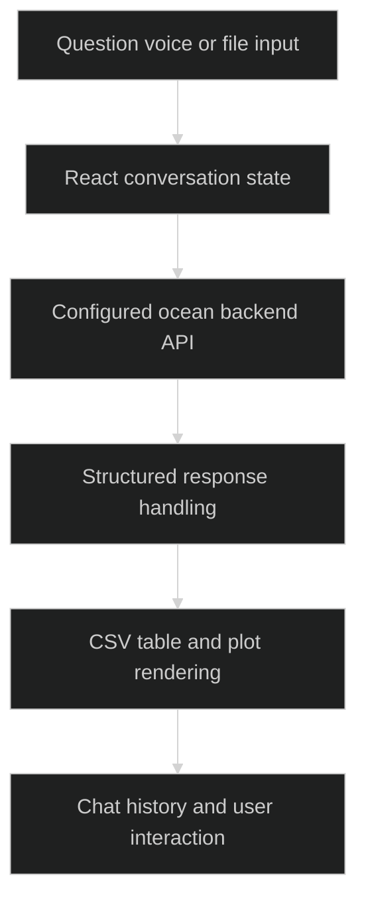

# Anantha Frontend

> `An ocean-data conversation client with tables, plots, voice input and document interactions.`

### 🏗️ System Architecture



### 🛠️ Production Stack

React · TypeScript · Vite · Tailwind CSS · shadcn/ui · browser speech APIs · Gemini client integration

### ⚡ Key Engineering Capabilities

- Typed response handling connects narrative and data-oriented answers.
- CSV visualization components expose retrieved datasets.
- Voice and file workflows complement typed ocean-data queries.

### 🚀 Deployment and Local Setup

Run from the repository root after cloning:

```bash
git clone https://github.com/ryash14/Anantha-Frontend.git
cd Anantha-Frontend
npm install
npm run dev
# For a static deployment build:
# npm run build
```

Configure the backend endpoint in `src/utils/api.ts` and run a compatible Anantha backend. The main page includes direct provider access; private credentials must move behind a server boundary before public deployment. Browser voice support depends on platform capabilities. This repository is the client, not the retrieval backend.

### Verification

```bash
npm run lint
npm run build
```

These commands are provided by the source configuration; this documentation update does not claim a fresh end-to-end application run.

### Source Map

- [src/utils/api.ts](src/utils/api.ts)
- [src/pages/Index.tsx](src/pages/Index.tsx)
- [src/types/index.ts](src/types/index.ts)
